<a href="https://github.com/karteyareddy">
  <picture><source media="(max-width: 700px)" srcset="assets/sp-hero-m-auto.svg"><source media="(prefers-color-scheme: light)" srcset="assets/sp-hero-light.svg"></picture>
</a>

<p align="center">
  <a href="https://www.linkedin.com/in/kristipati-karteya-reddy-947247136/">LinkedIn</a> &nbsp;·&nbsp;
  <a href="https://x.com/KarteyaReddy">X</a> &nbsp;·&nbsp;
  <a href="https://www.instagram.com/karteyareddy/">Instagram</a> &nbsp;·&nbsp;
  <a href="mailto:reddykarteya@gmail.com">reddykarteya@gmail.com</a> &nbsp;·&nbsp;
  <a href="#selected-work">Selected work</a>
</p>

<picture><source media="(max-width: 700px)" srcset="assets/sp-h-about-m-auto.svg"><source media="(prefers-color-scheme: light)" srcset="assets/sp-h-about-light.svg"></picture>

I'm Karthi, a Computer Science student specialising in **Artificial Intelligence & Machine Learning** at Kalasalingam Academy of Research and Education (class of 2028, CGPA 9.38), and Treasurer of the KARE IEEE Robotics and Automation Society, where I was previously Machine Learning Head.

The part of AI I like most comes after the notebook: wiring a model into something a person can open and trust. That has meant a knee-MRI classifier with explainable heatmaps, a sign-recognition model that knows when to defer to a human interpreter, a traffic optimiser that has to cope with fog and flooding, and a care app that families use every day.

My work sits where **computer vision, language and learning systems** meet **full-stack engineering**: Python and PyTorch for the models, TypeScript and Next.js for the product, Supabase or PostgreSQL underneath, and lately Qiskit when a problem is worth a quantum detour.

<picture><source media="(max-width: 700px)" srcset="assets/sp-h-arsenal-m-auto.svg"><source media="(prefers-color-scheme: light)" srcset="assets/sp-h-arsenal-light.svg">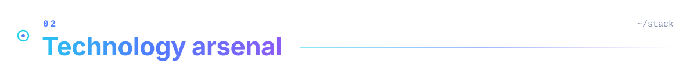</picture>

<picture><source media="(max-width: 700px)" srcset="assets/sp-arsenal-m-auto.svg"><source media="(prefers-color-scheme: light)" srcset="assets/sp-arsenal-light.svg"></picture>

<a id="selected-work"></a>
<picture><source media="(max-width: 700px)" srcset="assets/sp-h-projects-m-auto.svg"><source media="(prefers-color-scheme: light)" srcset="assets/sp-h-projects-light.svg"></picture>

<a href="https://github.com/karteyareddy/Q-TrafficX"><picture><source media="(max-width: 700px)" srcset="assets/sp-p-qtrafficx-m-auto.svg"><source media="(prefers-color-scheme: light)" srcset="assets/sp-p-qtrafficx-light.svg"></picture></a>

A hybrid quantum-classical traffic platform for a 6-intersection network. Rain, flooding, fog, accidents and emergency vehicles reshape demand, and the system rebuilds signal timing and routing as QUBO problems on each update, solved with QAOA on Qiskit Aer and refined classically. Real-time monitoring, flood/fog awareness, an interactive 2D/3D digital twin, and 181 passing tests. Top 30 at the Quantexa Hackathon.
**[Repository →](https://github.com/karteyareddy/Q-TrafficX)**

<picture><source media="(max-width: 700px)" srcset="assets/sp-p-scanoraai-m-auto.svg"><source media="(prefers-color-scheme: light)" srcset="assets/sp-p-scanoraai-light.svg"></picture>

A multi-modal screening platform I co-developed: camera-based kinematic analysis plus a ResNet18 classifier for knee-MRI pathology. The model handles 12 labels at once and reached **94.1% binary accuracy, 86.5% macro F1 and 96.8% mean ROC-AUC** across the 10 evaluated classes. Grad-CAM heatmaps show which regions drove each prediction, and a Streamlit interface prepares AI-assisted reports for a clinician to review.
*Repository not public yet.*

<picture><source media="(max-width: 700px)" srcset="assets/sp-p-learnx-m-auto.svg"><source media="(prefers-color-scheme: light)" srcset="assets/sp-p-learnx-light.svg"></picture>

An AI-powered learning platform. Learners create subjects dynamically, topics become an interactive knowledge graph, and Gemini answers questions in context. Revision runs on flashcards with spaced repetition, with Node.js and Supabase managing the learning data behind it.
*Repository not public yet.*

<a href="https://github.com/karteyareddy/ISL"><picture><source media="(max-width: 700px)" srcset="assets/sp-p-signbridge-m-auto.svg"><source media="(prefers-color-scheme: light)" srcset="assets/sp-p-signbridge-light.svg"></picture></a>

An accessibility network for hospitals, stations and service counters. A QR code at the counter opens phrase cards and offline service packs with no install. Hand and pose landmarks are extracted in the browser with MediaPipe, so frames never leave the device. A FastAPI model only answers above an 85% confidence threshold; below it, the user is routed to visual phrase selection or a human interpreter.
**[Repository →](https://github.com/karteyareddy/ISL)**

<a href="https://bed-care-connect.vercel.app"><picture><source media="(max-width: 700px)" srcset="assets/sp-p-bedcare-m-auto.svg"><source media="(prefers-color-scheme: light)" srcset="assets/sp-p-bedcare-light.svg"></picture></a>

Shipped and live. Families and caretakers of bedridden patients get structured task scheduling, real-time dashboards and role-based access, while Gemini reads case sheets and summarises medical history for whoever is on shift. Built with Next.js and Supabase, and packaged for Android with Capacitor.
**[Live app →](https://bed-care-connect.vercel.app)** · **[Repository →](https://github.com/karteyareddy/BedCare-Connect)**

<a href="https://github.com/karteyareddy/Whatsapp_Bot"><picture><source media="(max-width: 700px)" srcset="assets/sp-p-replywise-m-auto.svg"><source media="(prefers-color-scheme: light)" srcset="assets/sp-p-replywise-light.svg"></picture></a>

A local dashboard for WhatsApp that decides whether to reply, drafts what to say, and remembers context per contact. It falls back across Gemini, OpenRouter, Groq and a local provider, and every message waits for a human to approve it.
**[Repository →](https://github.com/karteyareddy/Whatsapp_Bot)**

#### Also live

- **Smart Campus Academic Hub**: timetables, free classrooms, professor schedules and study material in one place. React · Vite · Supabase. [Live](https://campus-hub-navigator.vercel.app) · [Code](https://github.com/karteyareddy/campus-hub-navigator)
- **Prompt Engineering event platform**: team registration, payment-proof upload, admin verification and QR entry passes for a campus event. Next.js · Supabase · Three.js. [Live](https://promt-engineering-indol.vercel.app) · [Code](https://github.com/karteyareddy/promt-engineering)

<details>
<summary><b>More builds</b> (repositories not public yet)</summary>
<br>

- **AgriSmart**: IoT irrigation with ESP32/ESP8266, soil-moisture sensing, Firebase and automated pump control.
- **EduCred**: digital credential verification using Django, PostgreSQL, JWT and hash-based credential checks.
- **Movie Genre Predictor**: NLP genre classification with TF-IDF and embeddings feeding classical ML classifiers.

</details>

<picture><source media="(max-width: 700px)" srcset="assets/sp-h-leadership-m-auto.svg"><source media="(prefers-color-scheme: light)" srcset="assets/sp-h-leadership-light.svg"></picture>

<picture><source media="(max-width: 700px)" srcset="assets/sp-impact-m-auto.svg"><source media="(prefers-color-scheme: light)" srcset="assets/sp-impact-light.svg">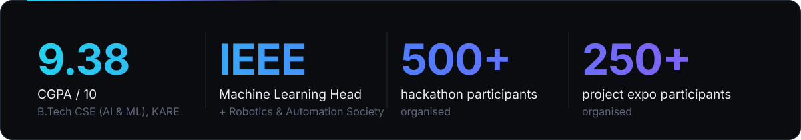</picture>

**Experience**

- **Treasurer, KARE IEEE Robotics and Automation Society** · Aug 2026 – present. Progressed from Machine Learning Head (Dec 2025 – Aug 2026); technical initiatives, society operations and financial coordination.
- **Machine Learning Head, KARE IEEE RAS** · Dec 2025 – Aug 2026. Led AI/ML workshops and mentorship engaging 500+ students; helped organise a hackathon with 500+ participants and a project expo with 250+.
- **AI Intern, SmartEd** · Sep – Oct 2025. Facial-recognition workflows in Python and OpenCV: image processing, face detection, and user identification and authentication.

**Achievements**

- **Top 30, Quantexa Hackathon** for Q-TrafficX, the quantum-inspired traffic simulation.
- **Runner-up, CIH26 Hackathon**, recognised for competitive project development.
- **IEEE Xtreme 20.0 Student Branch Ambassador**, promoting the 24-hour programming competition on campus.

**Education**

- **B.Tech, Computer Science and Engineering (AI & ML)**, Kalasalingam Academy of Research and Education · 2024 – 2028 · CGPA 9.38/10
- **Intermediate (MPC)**, Narayana IIT Academy, Kondapur · 2022 – 2024 · 89.2%

<picture><source media="(max-width: 700px)" srcset="assets/sp-h-telemetry-m-auto.svg"><source media="(prefers-color-scheme: light)" srcset="assets/sp-h-telemetry-light.svg">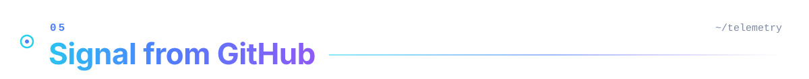</picture>

<picture><source media="(prefers-color-scheme: light)" srcset="assets/sp-telemetry-light.svg"></picture>

<picture><source media="(max-width: 700px)" srcset="assets/sp-h-now-m-auto.svg"><source media="(prefers-color-scheme: light)" srcset="assets/sp-h-now-light.svg">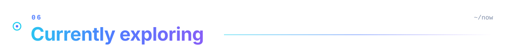</picture>

```text
agents         tool use, planning and evaluation for LLM agents that act and don't just chat
deep learning  temporal models for sign and gesture sequences
advanced ML    explainability, calibration, knowing when a model should abstain
full-stack AI  shipping models behind real products: latency, cost, offline-first
```

<picture><source media="(max-width: 700px)" srcset="assets/sp-h-connect-m-auto.svg"><source media="(prefers-color-scheme: light)" srcset="assets/sp-h-connect-light.svg"></picture>

Open to internships, research collaborations and hackathon teams, especially anything involving AI products with real users.

<p>
  <a href="https://www.linkedin.com/in/kristipati-karteya-reddy-947247136/"><picture><source media="(prefers-color-scheme: light)" srcset="assets/sp-link-linkedin-light.svg"></picture></a>&nbsp;
  <a href="https://x.com/KarteyaReddy"><picture><source media="(prefers-color-scheme: light)" srcset="assets/sp-link-x-light.svg"></picture></a>&nbsp;
  <a href="https://www.instagram.com/karteyareddy/"><picture><source media="(prefers-color-scheme: light)" srcset="assets/sp-link-instagram-light.svg"></picture></a>&nbsp;
  <a href="mailto:reddykarteya@gmail.com"><picture><source media="(prefers-color-scheme: light)" srcset="assets/sp-link-email-light.svg"></picture></a>&nbsp;
  <a href="https://github.com/karteyareddy?tab=repositories"><picture><source media="(prefers-color-scheme: light)" srcset="assets/sp-link-github-light.svg"></picture></a>
</p>

<picture><source media="(max-width: 700px)" srcset="assets/sp-end-m-auto.svg"><source media="(prefers-color-scheme: light)" srcset="assets/sp-end-light.svg">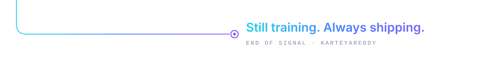</picture>
